# Visitor Counter Web Application
### Docker • Kubernetes • HPA • Hybrid Failover • Resource Optimization

> **Cloud Computing Class Project**  
> A Flask-based visitor counter application deployed using Docker and Kubernetes, demonstrating containerization, self-healing, autoscaling, hybrid failover simulation, and resource optimization.

---

## 📌 Project Overview

This project demonstrates the deployment and management of a web application using Docker containerization and Kubernetes orchestration.

The application is developed using **Python Flask** and uses **Redis** to store visitor count data. Docker is used to containerize the application, while Kubernetes manages deployments, pods, services, health checks, self-healing, and scaling.

The project also includes a simulated hybrid environment using two local Kubernetes clusters to demonstrate failover, along with practical resource optimization techniques.

Developed as part of a **Cloud Computing Class Project**, this project provides hands-on experience with cloud-native application deployment, container orchestration, availability, scalability, and resource efficiency.

---

## 🎯 Objectives

- Containerize the Flask application using Docker.
- Deploy the application and Redis using Kubernetes.
- Demonstrate Kubernetes self-healing.
- Implement Horizontal Pod Autoscaling (HPA).
- Simulate a primary and secondary Kubernetes cluster.
- Demonstrate failover during primary cluster failure.
- Optimize Docker image size.
- Reduce CPU and memory requests and limits.
- Compare resource configurations before and after optimization.

---

## 🛠️ Technology Stack

| Technology | Purpose |
|---|---|
| Python | Application programming language |
| Flask | Web application framework |
| Redis | Visitor count storage |
| Docker | Containerization |
| Docker Compose | Local multi-container execution |
| Kubernetes | Container orchestration |
| Minikube | Local Kubernetes environment |
| kubectl | Kubernetes management |
| Metrics Server | Resource metrics collection |
| HPA | Automatic horizontal scaling |

---

# 🏗️ System Architecture

The project contains two Kubernetes environments:

### Primary Cluster
- Flask application
- Redis
- NodePort service
- 2 initial application replicas
- Horizontal Pod Autoscaler
- Self-healing enabled through Kubernetes

### Secondary Cluster
- Flask application
- Redis
- 2 application replicas
- Optimized Docker image
- Reduced resource allocation
- Used for failover simulation

### Architecture Diagram

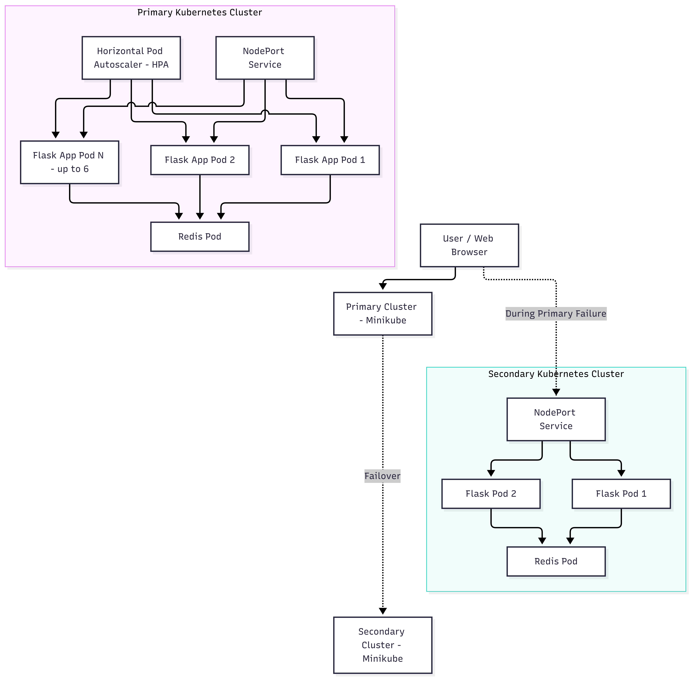

---

# 📂 Project Structure

```text
visitor-counter-kubernetes/
│
├── app/
│   ├── app.py
│   └── requirements.txt
│
├── kubernetes/
│   ├── app-deployment.yaml
│   └── redis-deployment.yaml
│
├── screenshots/
│   ├── 01_minikube_cluster_setup.png
│   ├── 02_kubernetes_system_pods.png
│   ├── 03_docker_image_loaded.png
│   ├── 04_redis_deployment_created.png
│   ├── 05_redis_pod_verification.png
│   ├── 06_kubernetes_deployments_running.png
│   ├── 07_visitor_counter_application.png
│   ├── 08_self_healing_initial_status.png
│   ├── 09_self_healing_pod_deletion.png
│   ├── 10_self_healing_pod_recreation.png
│   ├── 11_hpa_configuration.png
│   ├── 12_CPU_Load_Generation.png
│   ├── 13_HPA_Scalling.png
│   ├── 14_Scaled_Pods.png
│   ├── 15_hpa_scaling_success.png
│   ├── 16_hpa_scale_down.png
│   └── ... additional screenshots
│
├── architecture_diagram.png
├── Dockerfile
├── docker-compose.yml
├── k8s.yaml
├── hpa.yaml
├── .dockerignore
├── .gitignore
└── readme.md
```

---

# 🚀 Project Implementation

## 1️⃣ Docker Containerization

The Flask application was packaged into a Docker image to make it portable and consistent across environments.

### Docker Image

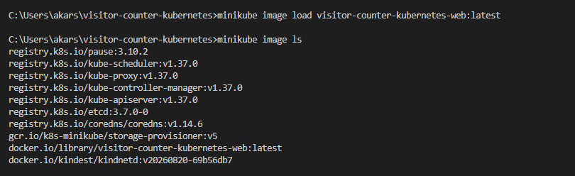

Docker was used to create the application image and execute the application in an isolated container environment.

### Docker Compose

Docker Compose was used to run the Flask application and Redis together during local testing.

```bash
docker compose up --build
```

Stop the services:

```bash
docker compose down
```

---

## 2️⃣ Kubernetes Deployment

The application and Redis were deployed on a local Kubernetes cluster using Minikube.

### Minikube Cluster Setup


### Kubernetes System Components

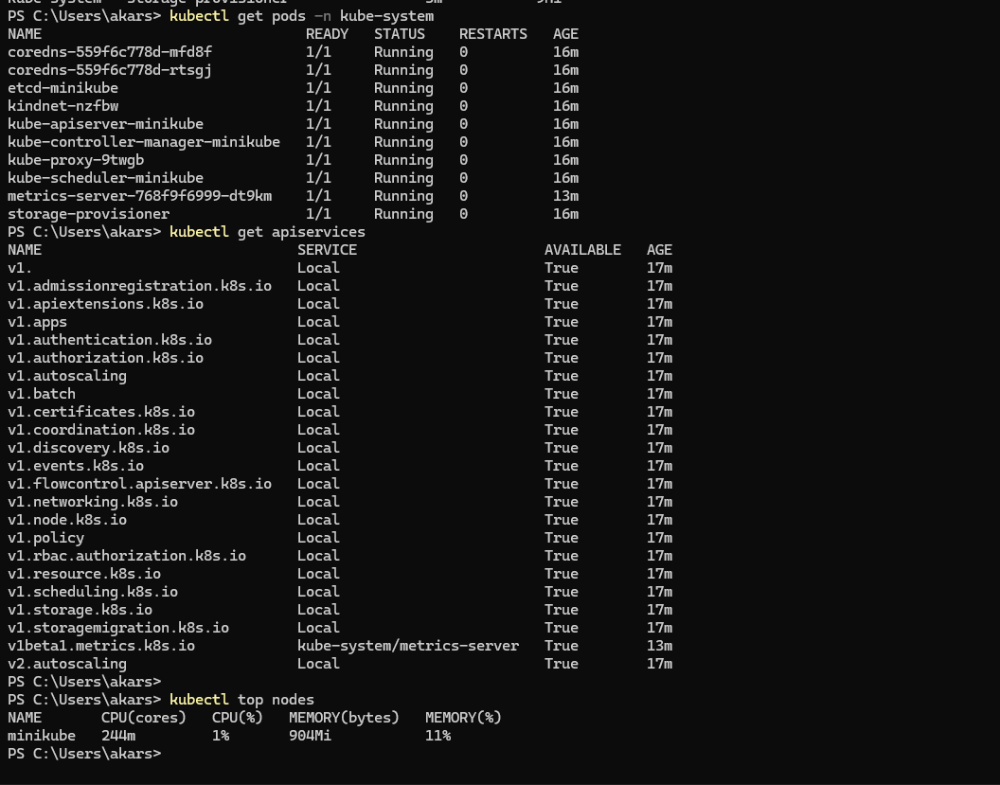

### Redis Deployment

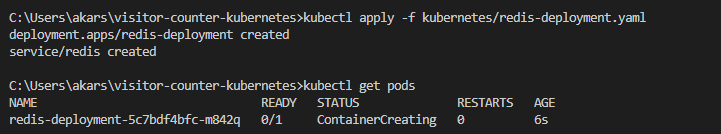

### Redis Pod Verification

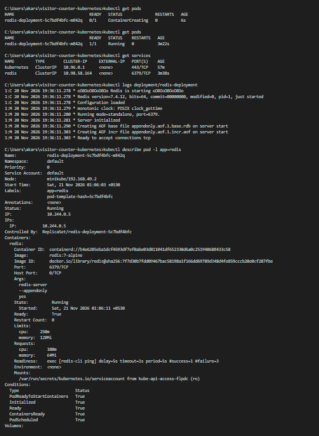

### Application Deployment

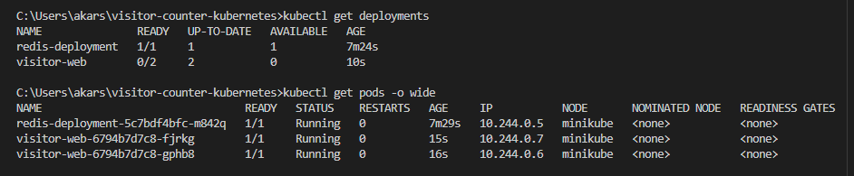

The application is deployed with two Flask replicas, while Redis runs as a separate deployment.

---

## 🌐 Application Preview

The visitor counter application is exposed using a Kubernetes NodePort service.

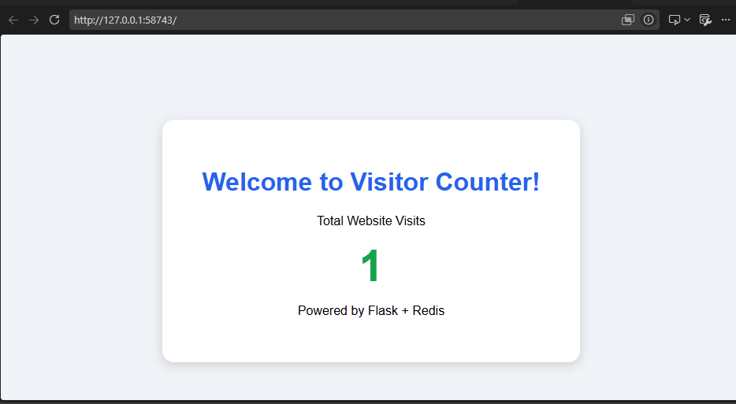

The Flask application communicates with Redis to maintain and update the visitor counter.

---

# ♻️ 3️⃣ Kubernetes Self-Healing

Kubernetes self-healing was demonstrated by deleting a running application pod and observing the automatic creation of a replacement.

### Initial Pod Status


### Pod Deletion

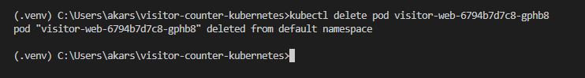

### Automatic Pod Recreation

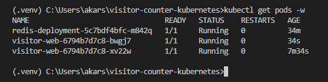

Kubernetes continuously maintains the desired number of replicas. When a pod is deleted, the deployment controller automatically creates a replacement.

---

# 📈 4️⃣ Horizontal Pod Autoscaling (HPA)

The application was configured to scale based on CPU utilization.

| Configuration | Value |
|---|---:|
| Minimum Replicas | 2 |
| Maximum Replicas | 6 |
| Target CPU Utilization | 50% |

### HPA Configuration

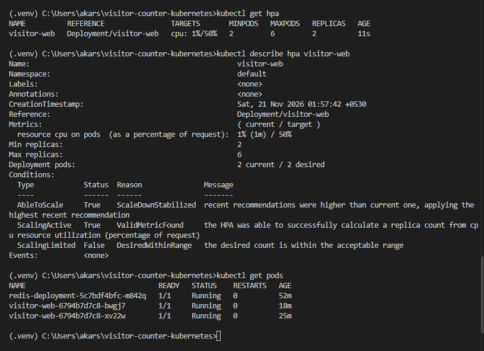

### CPU Load Generation

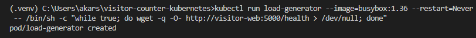

### HPA Scaling Activity

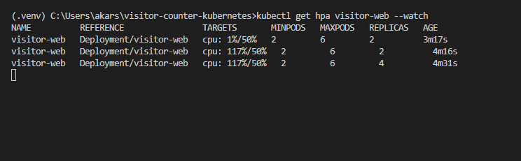

### Scaled Pods


### Scaling Demonstration

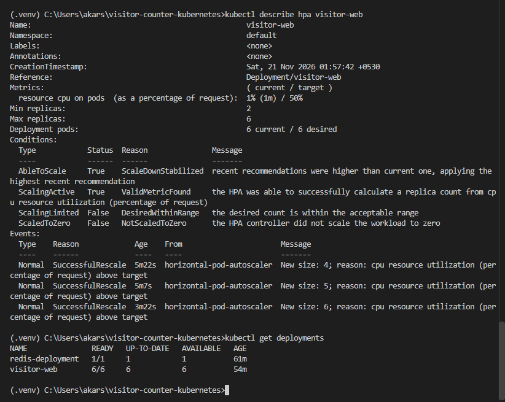

### Scale Down


The application successfully scaled from **2 replicas to 6 replicas** during CPU load generation and returned to **2 replicas** after the load was stopped.

---

# 🌐 5️⃣ Hybrid Cluster & Failover Simulation

Two local Kubernetes clusters were used to simulate a primary and secondary environment.

| Cluster | Role |
|---|---|
| Primary | Main application deployment |
| Secondary | Backup/failover environment |

The secondary cluster was tested during the primary cluster failure simulation. The application remained accessible through the secondary environment.

### Primary Cluster Failure

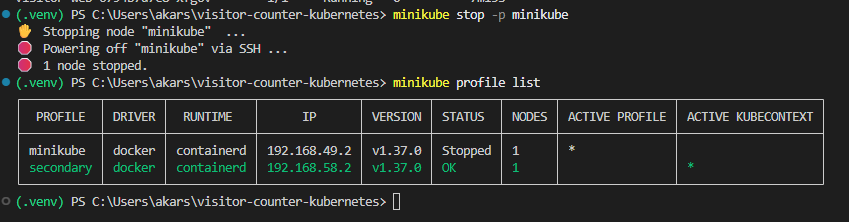

### Secondary Cluster Status

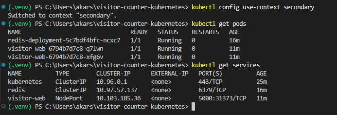

### Application Accessible After Failover

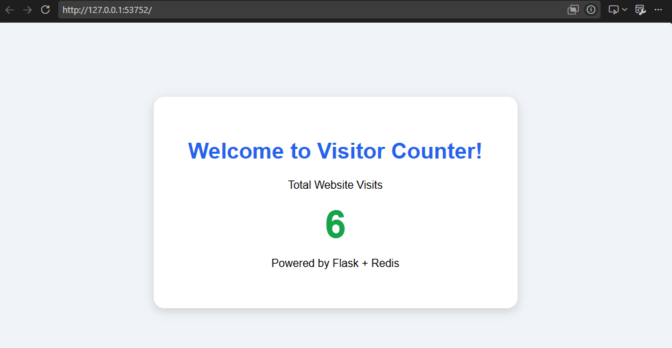

### Primary Cluster Restoration

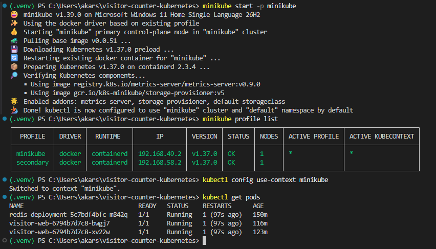

> This is a local failover simulation using Minikube clusters, not a deployment across real cloud providers or geographically distributed regions.

---

# 💰 6️⃣ Cost & Resource Optimization

Three optimization techniques were demonstrated:

1. Docker image size reduction
2. Kubernetes CPU and memory optimization
3. Dynamic scaling using HPA

---

## Optimization 1 — Docker Image Size Reduction

The original Docker image was optimized using a lightweight Python Alpine base image and reduced build overhead.

| Version | Image Size |
|---|---:|
| Original Image | 53.65 MB |
| Optimized Image | 21.74 MB |

### Image Optimization Result

**Approximately 59.5% reduction in Docker image size.**

---

## Optimization 2 — Kubernetes Resource Optimization

CPU and memory requests and limits were reduced in the optimized secondary deployment.

| Resource | Before | After | Reduction |
|---|---:|---:|---:|
| CPU Request | 100m | 50m | 50% |
| Memory Request | 128Mi | 64Mi | 50% |
| CPU Limit | 500m | 250m | 50% |
| Memory Limit | 256Mi | 128Mi | 50% |

### Optimized Secondary Cluster

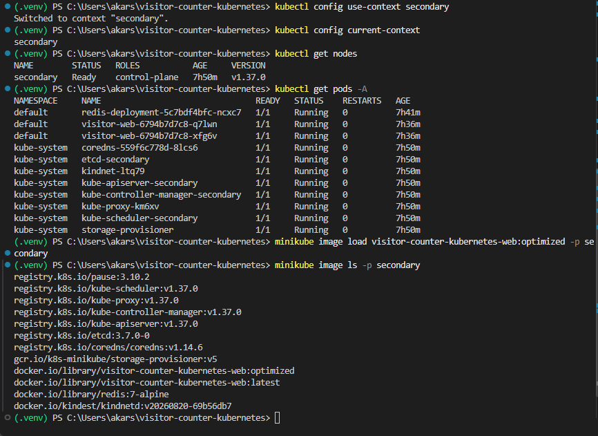

### Optimized Deployment

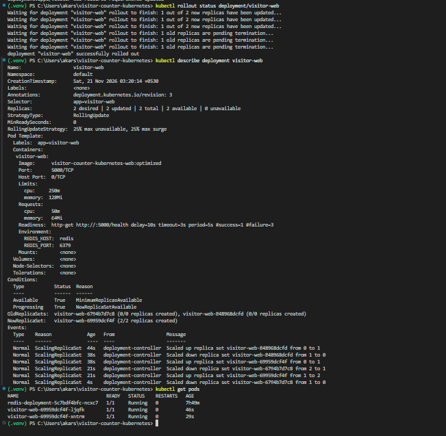

### Optimized Application Running

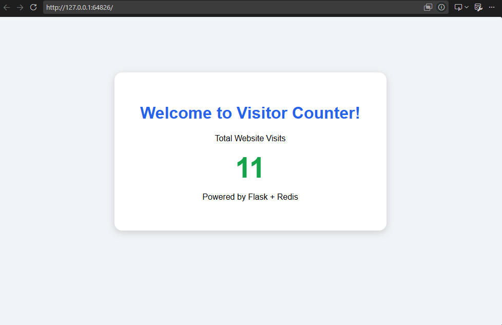

---

## Optimization 3 — Dynamic Scaling

Instead of using a fixed number of replicas, HPA adjusts the replica count according to CPU utilization.

| Metric | Value |
|---|---|
| Minimum replicas | 2 |
| Maximum replicas | 6 |
| CPU target | 50% |
| Scale-up | 2 → 6 |
| Scale-down | 6 → 2 |

This allows the application to use additional replicas when demand increases and reduce replicas when demand decreases.

---

## 📊 Optimization Summary

| Technique | Demonstrated Result |
|---|---|
| Docker image optimization | ≈59.5% smaller image |
| CPU resource optimization | 50% reduction in requests and limits |
| Memory optimization | 50% reduction in requests and limits |
| HPA | Dynamic scaling between 2–6 replicas |

> These measurements represent local image-size and resource configuration improvements. Actual cloud billing savings were not measured because the project was executed using local Minikube clusters.

---

# 📸 Screenshots & Practical Evidence

Screenshots are stored in the `screenshots/` folder and provide evidence of the following:

- Minikube setup
- Kubernetes system pods
- Docker image creation
- Redis deployment
- Application deployment
- Visitor counter in browser
- Self-healing pod recreation
- HPA configuration
- CPU load generation
- Autoscaling
- Scale-down behavior
- Primary and secondary clusters
- Failover simulation
- Optimized Docker image
- Resource optimization
- Secondary cluster application

---

# 📋 Results

The project successfully demonstrated:

- Flask visitor counter application
- Redis integration
- Docker containerization
- Docker Compose deployment
- Kubernetes deployment
- Kubernetes self-healing
- Horizontal Pod Autoscaling
- CPU-based scale-up and scale-down
- Hybrid failover simulation
- Docker image optimization
- Kubernetes resource optimization

---

# ⚠️ Limitations

- The Kubernetes environments were deployed locally using Minikube.
- Failover was simulated locally rather than across actual cloud providers.
- No cloud billing data was collected.
- Cost optimization is evaluated through image size and resource configuration.
- Production-level networking, persistent storage, security, monitoring, and disaster recovery were not implemented.

---

# 🔮 Future Scope

Possible future enhancements include:

- Deployment on AWS, Azure, or Google Cloud
- Real multi-cloud failover
- Cross-region disaster recovery
- Persistent Redis storage
- CI/CD using GitHub Actions
- Monitoring using Prometheus and Grafana
- Ingress and domain-based routing
- Kubernetes security and secrets management
- Infrastructure as Code using Terraform
- Cloud cost monitoring

---

# 👨‍💻 Author

**Akarsh Kumar**  
B.Tech – Computer Science & Engineering  
Batch: 3CSE2  
Roll No.: 2410030259

**Cloud Computing Project**

---

⭐ *A hands-on project exploring containerization, orchestration, autoscaling, resilience, and resource optimization.*
