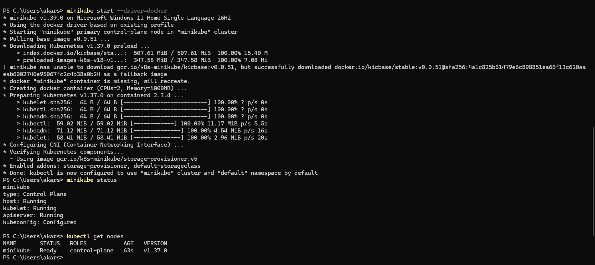
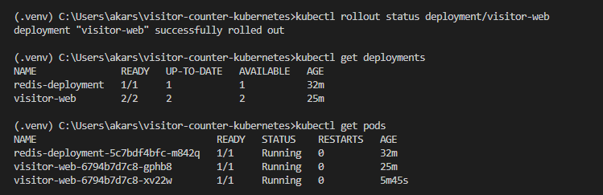
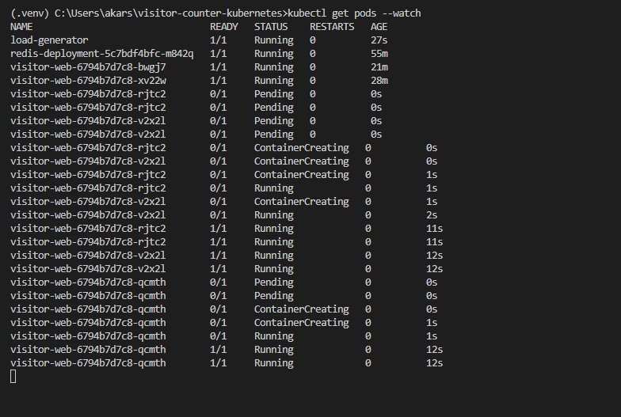
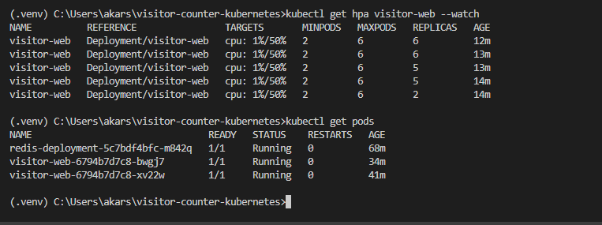

# Visitor Counter Application using Docker and Kubernetes

## 1. Project Overview

The Visitor Counter Application is a containerized web application developed using Python Flask and Redis. It counts the total number of visits to a website and demonstrates how modern containerization and orchestration technologies can be used to deploy, manage, and scale applications.

The project uses Docker to containerize the application and Redis database, while Kubernetes manages application deployment, service discovery, self-healing, and automatic scaling.

The main objective is to understand how containerized applications work in a distributed environment and how Kubernetes maintains application availability under changing workloads.

## 2. Technologies Used

| Technology | Purpose |
|---|---|
| Python | Backend programming language |
| Flask | Web application framework |
| Redis | In-memory database for storing visitor counts |
| Docker | Application containerization |
| Docker Compose | Multi-container management |
| Kubernetes | Container orchestration |
| Minikube | Local Kubernetes cluster |
| kubectl | Kubernetes command-line management |
| Docker Desktop | Container runtime and management |
| BusyBox | Temporary load-generation container |

## 3. Project Structure

```text
visitor-counter-kubernetes/
│
├── app/                                                            # Contains the Flask application
│   ├── app.py                                                      # Main Python file; handles visitor counting
│   └── requirements.txt                                            # Python dependencies (Flask, Redis, Gunicorn)
│
├── kubernetes/                                                     # Kubernetes deployment configuration files
│   ├── app-deployment.yaml                                         # Deploys Flask app and exposes it through a Service
│   ├── redis-deployment.yaml                                       # Deploys Redis and creates its internal Service
│   └── hpa.yaml                                                    # Configures automatic pod scaling based on CPU usage
│
├── screenshots/                                                    # Evidence of project execution and testing
│   ├── 01_minikube_cluster_setup.png  
│   ├── 02_kubernetes_system_pods.png 
│   ├── 03_docker_image_loaded.png    
│   ├── 04_redis_deployment_created.png 
│   ├── 05_redis_pod_verification.png 
│   ├── 06_kubernetes_deployments_running.png 
│   ├── 07_visitor_counter_application.png 
│   ├── 08_self_healing_initial_status.png 
│   ├── 09_self_healing_pod_deletion.png 
│   ├── 10_self_healing_pod_recreation.png 
│   ├── 11_hpa_configuration.png      
│   ├── 12_CPU_Load_Generation.png    
│   ├── 13_HPA_Scaling.png           
│   ├── 14_Scaled_Pods.png            
│   ├── 15_hpa_scaling_success.png   
│   └── 16_hpa_scale_down.png        
│
├── .dockerignore                                                   # Excludes unnecessary files from Docker build context
├── .gitignore                                                      # Prevents unwanted files from being uploaded to GitHub
├── docker-compose.yml                                              # Runs Flask and Redis together using Docker Compose
├── Dockerfile                                                      # Instructions for building the Flask Docker image
└── README.md                                                       # Project overview, setup instructions and documentation
```

## 4. Application Architecture

The application consists of two primary services:

### Flask Web Application

Flask handles incoming HTTP requests, communicates with Redis, and displays the total number of website visits.

### Redis Database

Redis stores the visitor count in memory and updates the count whenever a visitor accesses the application.

### Architecture Flow

```text
          User / Browser
                |
                v
          Flask Web App
           Port 5000
                |
                v
             Redis
           Port 6379
                |
                v
        Visitor Count Storage
```

Docker Compose manages the application and Redis containers together. Kubernetes manages their deployment through Pods, Deployments, and Services.

## 5. Running the Application Using Docker

### Step 1: Build and start the containers

```bash
docker compose up --build -d
```

### Step 2: Verify running containers

```bash
docker compose ps
```

### Step 3: Check application logs

```bash
docker compose logs -f web
```

### Step 4: Access the application

Open the following address in your browser:

```text
http://localhost:5000
```

### Step 5: Stop the containers

```bash
docker compose down
```

## 6. Kubernetes Cluster Setup

Minikube is used to create a local Kubernetes cluster with Docker Desktop as the container driver.

### Step 1: Start Minikube

```bash
minikube start --driver=docker
```

### Step 2: Check Minikube status

```bash
minikube status
```

### Step 3: Verify Kubernetes nodes

```bash
kubectl get nodes -o wide
```

### Step 4: Verify Kubernetes system Pods

```bash
kubectl get pods -A
```

### Step 5: Enable Metrics Server

```bash
minikube addons enable metrics-server
```

Verify node resource utilization:

```bash
kubectl top nodes
```

Verify Pod resource utilization:

```bash
kubectl top pods
```

## 7. Deploying the Application on Kubernetes

### Step 1: Load the Docker image into Minikube

```bash
minikube image load visitor-counter-kubernetes-web:latest
```

### Step 2: Verify the loaded image

```bash
minikube image ls
```

### Step 3: Deploy Redis

```bash
kubectl apply -f kubernetes/redis-deployment.yaml
```

### Step 4: Deploy the Flask application

```bash
kubectl apply -f kubernetes/app-deployment.yaml
```

### Step 5: Verify Kubernetes Deployments

```bash
kubectl get deployments
```

### Step 6: Verify running Pods

```bash
kubectl get pods -o wide
```

### Step 7: Check Kubernetes Services

```bash
kubectl get services
```

### Step 8: Access the application

```bash
minikube service visitor-web --url
```

Open the generated URL in your browser to access the Visitor Counter Application.

## 8. Kubernetes Self-Healing Demonstration

One of the important features demonstrated in this project is Kubernetes self-healing.

Kubernetes Deployments maintain the desired number of application replicas. If a Pod is deleted or fails, Kubernetes automatically creates a replacement Pod to maintain the desired state.

### Step 1: Check the initial deployment status

```bash
kubectl rollout status deployment/visitor-web
```

```bash
kubectl get deployments
```

```bash
kubectl get pods
```

**Observation:**

The visitor-web Deployment was running successfully with two application replicas.

### Step 2: Delete an application Pod

```bash
kubectl delete pod <POD_NAME>
```

Replace `<POD_NAME>` with the actual name of one visitor-web Pod.

**Observation:**

The selected application Pod was successfully deleted from the default namespace.

### Step 3: Observe automatic Pod recreation

```bash
kubectl get pods -w
```

**Observation:**

Kubernetes automatically created a replacement Pod to maintain the desired replica count.

The newly created Pod eventually reached the Running and Ready state.

### Result

The self-healing demonstration was successful.

Even after manually deleting an application Pod, Kubernetes automatically recreated it and maintained the desired number of replicas.

## 9. Horizontal Pod Autoscaling (HPA)

Horizontal Pod Autoscaling is a Kubernetes feature that automatically adjusts the number of running Pods based on resource utilization.

In this project, CPU utilization is used as the scaling metric.

### HPA Configuration

| Parameter | Configuration |
|---|---|
| Deployment | visitor-web |
| Minimum Replicas | 2 |
| Maximum Replicas | 6 |
| Target CPU Utilization | 50% |
| Scaling Metric | CPU |

### Step 1: Verify Metrics Server

```bash
kubectl top nodes
```

```bash
kubectl top pods
```

### Step 2: Configure Horizontal Pod Autoscaling

```bash
kubectl autoscale deployment visitor-web --cpu-percent=50 --min=2 --max=6
```

This command creates an HPA that maintains at least two replicas and can scale up to six replicas depending on CPU utilization.

### Step 3: Verify HPA configuration

```bash
kubectl get hpa
```

```bash
kubectl describe hpa visitor-web
```

### Step 4: Generate application load

A temporary BusyBox Pod is used to generate HTTP requests to the Flask application's health endpoint.

```bash
kubectl run load-generator --image=busybox:1.36 --restart=Never -- /bin/sh -c "while true; do wget -q -O- http://visitor-web:5000/health > /dev/null; done"
```

### Step 5: Monitor CPU utilization and scaling

Monitor the HPA:

```bash
kubectl get hpa visitor-web --watch
```

Monitor application Pods:

```bash
kubectl get pods --watch
```

Check resource utilization:

```bash
kubectl top pods
```

### Step 6: Observe automatic scale-up

When CPU utilization exceeds the configured target, Kubernetes increases the number of application replicas.

During the demonstration, CPU utilization reached approximately 54%, exceeding the 50% target.

The visitor-web Deployment scaled from two replicas to six replicas.

### Step 7: Stop the load generator

```bash
kubectl delete pod load-generator --ignore-not-found
```

### Step 8: Observe automatic scale-down

Monitor the HPA:

```bash
kubectl get hpa visitor-web --watch
```

Check the running Pods:

```bash
kubectl get pods
```

After the CPU load decreases, Kubernetes gradually reduces the number of replicas towards the configured minimum of two.

### Result

The Horizontal Pod Autoscaling demonstration successfully showed how Kubernetes automatically increases and decreases application replicas according to CPU utilization.

The application scaled up to six replicas during increased load and returned to two replicas after the load was removed.

## 10. Screenshots and Implementation Evidence

The following screenshots provide evidence of the project's implementation and demonstrations.

### Kubernetes Cluster Setup and Deployment

| Screenshot | Description |
|---|---|
|  | Minikube cluster initialization |
|  | Kubernetes system Pods verification |
|  | Loading the Docker image into Minikube |
|  | Redis Deployment and Service creation |
|  | Redis Pod running successfully |
|  | Kubernetes Deployment verification |
|  | Running Visitor Counter web application |

### Kubernetes Self-Healing

| Screenshot | Description |
|---|---|
|  | Initial application replica status |
|  | Manual deletion of an application Pod |
|  | Automatic replacement of the deleted Pod |

### Horizontal Pod Autoscaling

| Screenshot | Description |
|---|---|
|  | Initial HPA configuration |
|  | Generating application traffic |
|  | Monitoring HPA scaling activity |
|  | Application Pods after scaling |
|  | Successful HPA scale-up |
|  | Automatic scale-down after reducing load |

## 11. Project Outcomes

The following outcomes were achieved during the project:

- Developed a web-based Visitor Counter using Flask.
- Integrated Redis to maintain visitor count data.
- Containerized the application using Docker.
- Managed multiple containers using Docker Compose.
- Created and configured a local Kubernetes cluster using Minikube.
- Loaded and deployed the application image into Kubernetes.
- Configured Redis and Flask using Kubernetes Deployments and Services.
- Exposed the application through a Kubernetes NodePort Service.
- Enabled Metrics Server to monitor CPU and memory utilization.
- Successfully demonstrated Kubernetes self-healing through automatic Pod recreation.
- Configured Horizontal Pod Autoscaling using CPU utilization.
- Demonstrated automatic scaling from two to six replicas.
- Demonstrated automatic scale-down after removing the generated workload.

## 12. Future Improvements

The project can be extended with the following improvements:

1. **Cloud Deployment:** Deploy the application on managed Kubernetes services such as Amazon EKS, Azure AKS, or Google GKE.

2. **Advanced Monitoring:** Integrate Prometheus and Grafana to monitor application performance and Kubernetes resource utilization.

3. **Load Balancing:** Improve traffic distribution across multiple application replicas.

4. **Persistent Redis Storage:** Configure persistent storage to retain visitor count data across Redis container restarts.

5. **CI/CD Integration:** Implement automated build, testing, and deployment pipelines using GitHub Actions.

6. **Resource Optimization:** Optimize CPU and memory allocation to improve application efficiency and reduce infrastructure costs.

## 13. Conclusion

The Visitor Counter Application demonstrates the practical implementation of Docker and Kubernetes for deploying and managing containerized applications.

Flask handles the application logic, Redis stores visitor information, Docker provides containerization, and Kubernetes manages application deployment and orchestration.

The project successfully demonstrates two important Kubernetes capabilities: self-healing and Horizontal Pod Autoscaling.

The self-healing mechanism automatically replaces deleted Pods, while HPA adjusts the number of application replicas based on CPU utilization.

Overall, this project provides practical experience in containerization, orchestration, service management, resource monitoring, fault recovery, and automatic scaling.

---

**Project:** Visitor Counter Application using Docker and Kubernetes

**Primary Technologies:** Flask, Redis, Docker, Docker Compose, Kubernetes, Minikube, Python
